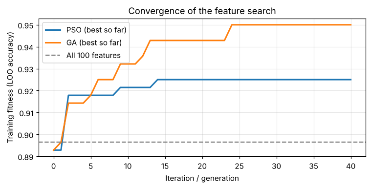
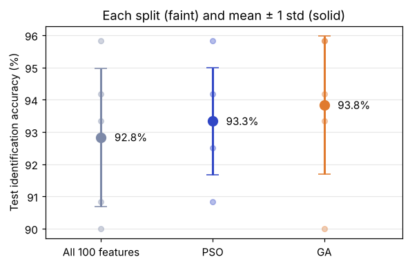
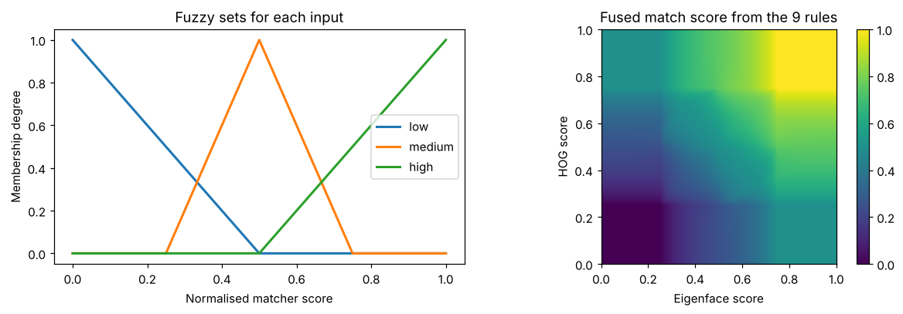
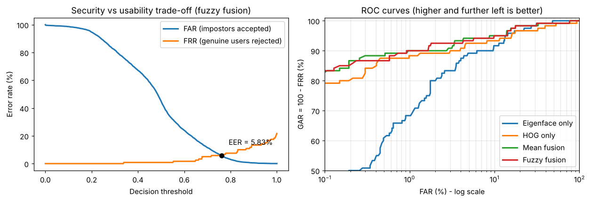
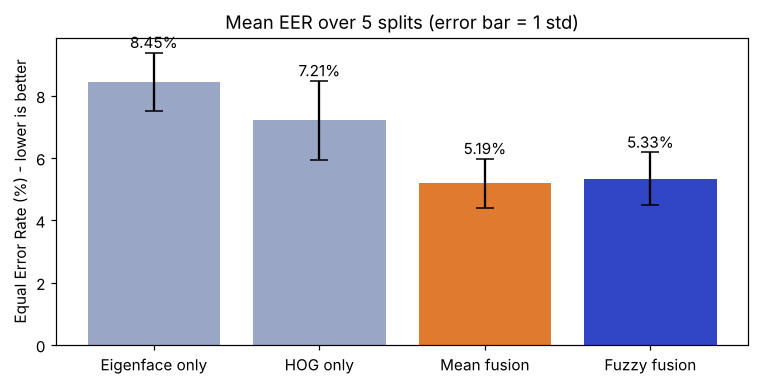

# Soft Computing for Biometric Authentication

Code and results for my Soft Computing course case study, based on this review paper:

> Houssein, E. H., Haridy, S. G. M., Wazery, Y. M., & Ali, A. A. (2026). *Soft Computing Techniques for Biometric Personal Authentication: Fundamentals, Challenges, and Open Issues.* Archives of Computational Methods in Engineering, 33, 14983–15013. https://doi.org/10.1007/s11831-026-10731-3

The paper reviews 153 studies. This project tests two of its main findings on a real face database:

| Part | Claim from the paper | What the notebook does |
|---|---|---|
| A | Swarm and evolutionary algorithms are the best feature selectors; PSO gains 3–8 accuracy points over using all features | Eigenface (PCA) face recognition; **binary PSO** and a **genetic algorithm** select a feature subset |
| B | Score-level fusion of several matchers is recommended, and fuzzy logic handles uncertain scores | Eigenface and HOG matchers fused with a **9-rule Sugeno fuzzy system**; FAR, FRR and EER compared |

## Results

All figures are averages over 5 random train/test splits, with 7 training and 3 test images per person.

### Part A: feature selection

Rank-1 identification accuracy:

| Method | Accuracy | Features used |
|---|---|---|
| All eigenface features | 92.8% | 100 |
| PSO-selected | 93.3% (+0.5) | about 54 |
| GA-selected | **93.8% (+1.0)** | about 55 |

PSO and the GA kept about half the features with slightly better average accuracy. The gain is smaller than the paper's 3–8 points and varies between splits, because the search partly over-fits a small training set.





### Part B: score fusion

Equal Error Rate (lower is better):

| System | EER |
|---|---|
| Eigenface matcher only | 8.45% |
| HOG matcher only | 7.21% |
| Mean score fusion | **5.19%** |
| Fuzzy score fusion | 5.33% |

Score-level fusion clearly lowered the error rate compared with either matcher alone. Fuzzy fusion performed about the same as the simple mean on these clean images.







## How to run

The notebook needs no GPU and takes about 1–3 minutes to run.

**Google Colab:** upload `Biometric_Soft_Computing_Implementation.ipynb` (File → Upload notebook), then choose Runtime → Run all.

**On your computer:**

```bash
git clone https://github.com/ROG-user-0987/Soft-Computing-Techniques-for-Biometric-Personal-Authentication.git
cd Soft-Computing-Techniques-for-Biometric-Personal-Authentication
pip install -r requirements.txt
jupyter notebook Biometric_Soft_Computing_Implementation.ipynb
```

The notebook reads the dataset from `data/`. If that folder is missing, it downloads the same data through scikit-learn.

## Repository structure

```
Soft-Computing-Techniques-for-Biometric-Personal-Authentication/
├── Biometric_Soft_Computing_Implementation.ipynb   # code, explanations and saved outputs
├── data/
│   ├── olivetti_faces.npy            # 400 face images, 64x64, values 0–1
│   └── olivetti_faces_target.npy     # person ID (0–39) for each image
├── results/                          # figures produced by the notebook
├── requirements.txt
└── README.md
```

## Dataset

Olivetti faces (the ORL / AT&T face database): 400 grey images of 40 people, 10 images each, taken between 1992 and 1994 at AT&T Laboratories Cambridge. The copy in `data/` matches the version distributed with scikit-learn (`sklearn.datasets.fetch_olivetti_faces`). Credit: AT&T Laboratories Cambridge.

## Author

Sriram Aditya Sai (1601-24-748-130), Department of CSE (AI&ML), CBIT, Hyderabad. Soft Computing course, 2026-27.
